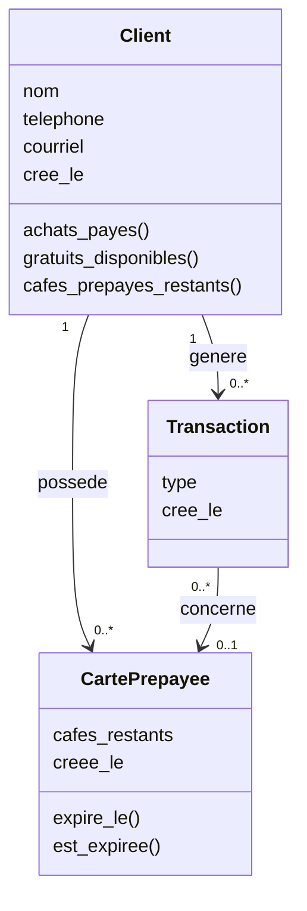

# Document de conception

Système de fidélité pour un café, version 1.

Ce document explique les choix faits pour les zones grises de l'énoncé (section 3), puis décrit l'architecture et les limites connues. Chaque décision suit le même plan : le choix, la justification, les alternatives écartées et les conséquences assumées.

## 1. Architecture

Application Django (SQLite, exécution locale) avec une seule app, `fidelite`, et trois modèles.

- **`Client`** : nom, téléphone (unique), courriel (facultatif).
- **`CartePrepayee`** : une carte de 11 cafés, liée à un client, avec le nombre de cafés restants.
- **`Transaction`** : le journal. Chaque événement de fidélité est une ligne, avec un `type` :

| Type | Signification |
|---|---|
| `ACHAT_PAYE` | Un café payé normalement (compte pour les 10 achats) |
| `CAFE_GRATUIT` | Un café gratuit de fidélité utilisé |
| `ACHAT_CARTE` | Un café pris sur une carte prépayée |
| `VENTE_CARTE` | Une carte prépayée vendue (l'argent est encaissé hors du système) |

Aucune classe de paiement n'existe, conformément à la section 2.6 de l'énoncé.

**Principe central : aucun compteur n'est stocké.** Les soldes (cafés gratuits, cafés sur carte) sont recalculés à partir du journal à chaque affichage. Il n'y a donc aucun chiffre qui puisse se désynchroniser du journal, et on garde l'historique complet.

## 2. Décisions sur les zones grises

### 2.1 Le 11e café gratuit et la carte prépayée : un mécanisme ou deux ?

**Choix : deux programmes indépendants, un seul journal.**

Les tampons (10 achats payés = 1 café gratuit) et la carte prépayée (11 cafés pour 10) sont deux concepts distincts, mais leurs événements sont enregistrés dans la même table `Transaction`, distingués par leur `type`.

- Un café pris sur une carte prépayée **ne compte pas** pour les tampons, car le client l'a déjà payé d'avance. Seuls les `ACHAT_PAYE` comptent.
- Acheter une carte ne modifie pas les tampons accumulés.
- Le propriétaire peut distinguer les deux programmes dans ses chiffres : il suffit de filtrer sur le type (l'administration offre ce filtre).

**Alternatives écartées :**
- *Un compteur unique de cafés « déjà payés »* : simple, mais il efface la différence entre les deux programmes et empêche de répondre à « combien de cartes ai-je vendues ce mois-ci ? ».
- *Une hiérarchie de classes (`AchatTampon`, `AchatCarte`, ...)* : elle produit des tables séparées, donc des requêtes plus lourdes pour retrouver tout l'historique d'un client. Elle force aussi « café gratuit » et « vente de carte » dans une classe `Achat` alors qu'ils ne sont pas des achats. Un champ `type` s'étend en une ligne, ce qui convient à un produit appelé à grossir à chaque devoir.

### 2.2 Le café gratuit : automatique ou en réserve ?

**Choix : en réserve, avec expiration après 30 jours.**

- Chaque 10e, 20e, 30e... café payé gagne un café gratuit, daté du jour de cet achat.
- Le client l'utilise quand il le décide. Le barista voit le nombre disponible et la date d'expiration du plus proche.
- Un café gratuit expire **30 jours** après avoir été gagné. Les achats payés qui le font gagner ne périment jamais.
- Un client peut accumuler plusieurs cafés gratuits. Quand il en utilise un, le plus ancien encore valide est consommé en premier.
- Le calcul rejoue le journal dans l'ordre chronologique : le 10e achat crée une récompense, chaque `CAFE_GRATUIT` en consomme une, puis on retire celles qui sont périmées. Un café expiré est refusé même si la requête est forcée : la vue revérifie le calcul avant d'enregistrer.

**Justification :** l'énoncé suggère qu'un client puisse vouloir garder sa récompense pour une boisson plus chère. L'expiration évite que des récompenses s'accumulent indéfiniment. La durée est une constante (`DUREE_EXPIRATION_JOURS`) facile à changer.

### 2.3 Comment reconnaît-on un client au comptoir ?

**Choix : le numéro de téléphone.**

- Le téléphone est **unique** et sert d'identifiant. Il est nettoyé à l'enregistrement : `418-555-1234`, `(418) 555 1234` et `+1 418 555 1234` deviennent tous `4185551234`. Deux écritures d'un même numéro ne créent donc pas de doublon.
- Le nom **n'est pas unique** : deux clientes peuvent s'appeler Sara. Le barista les distingue par le téléphone affiché à côté du nom.
- Le courriel **n'est pas unique** et il est facultatif : une famille peut partager une adresse (parents et enfants avec un courriel commun), alors qu'un numéro de téléphone personnel appartient presque toujours à une seule personne.
- La recherche porte sur le nom, le téléphone ou le courriel, sans tenir compte des majuscules ni des minuscules.

**Alternatives écartées :** le nom (doublons), le courriel (partagé, souvent absent). Un code sur carte physique ajouterait un objet que les clients perdent, ce que le propriétaire veut justement éviter.

## 3. Autres décisions de conception

### 3.1 Expiration de la carte prépayée

Une carte expire **30 jours après sa vente**. Passé ce délai, ses cafés restants ne sont plus utilisables et le compteur revient à 0.

- Le nombre `cafes_restants` n'est pas effacé de la base : l'expiration est calculée à l'affichage à partir de la date de vente. L'historique reste donc intact.
- Si le client possède plusieurs cartes valides, celle qui expire en premier est utilisée en premier, et une demande de plusieurs cafés peut puiser sur plusieurs cartes.
- L'administration affiche la date d'expiration et l'état « expirée » de chaque carte.

### 3.2 Plusieurs cafés d'un coup

Un client peut commander 2 ou 3 cafés à la fois. Le barista saisit une quantité (de 1 à 20), et le système crée **une transaction par café**. Chaque ligne du journal représente un seul café, ce qui garde les calculs cohérents. La quantité est bornée côté serveur, même si le formulaire est modifié.

### 3.3 La fidélité suit celui qui paie

Quand un client règle l'addition d'autres personnes, leurs achats peuvent être transférés à son compte : il suffit de changer le champ `client` de la transaction dans l'administration.

**Conséquence assumée :** la fidélité suit l'argent, pas la consommation. Un client qui paie régulièrement pour d'autres accumule ses tampons plus vite. La décision reste humaine : le barista juge chaque demande, le logiciel ne peut pas distinguer un geste ponctuel d'un abus répété. Aucun bouton de transfert n'a été codé pour cette version.

### 3.4 Validation des saisies

Les champs sont validés dans le formulaire avec des expressions régulières :

- **Nom** : des lettres (accents permis) séparées par un espace, un tiret ou une apostrophe ; au moins 2 lettres différentes (refuse `kk`, `Sara3`).
- **Téléphone** : chiffres, espaces, tirets et parenthèses ; il doit rester 10 chiffres au format nord-américain (indicatif et préfixe ne commençant pas par 0 ou 1). Un `1` initial est accepté.
- **Courriel** : `texte@domaine.extension`, avec une extension d'au moins 2 lettres ; mis en minuscules.

L'administration utilise **le même formulaire**, donc un client invalide ne peut pas y être créé non plus.

### 3.5 Écrans du comptoir

- L'écran de recherche n'affiche **aucun client tant qu'aucune recherche n'est faite** : avec des centaines de clients, une liste complète serait lente et inutile.
- Après la création d'un client, le barista est envoyé directement sur sa page d'achat.
- Les boutons « Utiliser un café gratuit » et « Utiliser la carte » n'apparaissent que si le client y a droit.

## 4. Limites connues

- **Annulation et remboursement** : le système ne rembourse rien (section 2.6). Annuler la vente d'une carte n'est pas géré. Supprimer une transaction `ACHAT_CARTE` dans l'administration ne remet pas le café sur la carte, car `cafes_restants` n'est pas recalculé.
- **Transfert de transactions** : possible par l'administration, sans bouton dédié ni trace d'audit.
- **Validation par expressions régulières** : elles vérifient le format, pas l'existence. Un numéro bien formé n'est pas forcément joignable et un prénom rare peut être refusé à tort. Les numéros hors Amérique du Nord ne sont pas acceptés.
- **Durées** : « 1 mois » est interprété comme 30 jours, pas comme un mois calendaire.
- **Aucune authentification** au comptoir : l'application suppose un ordinateur unique, utilisé par le personnel du café.
- **Tests automatisés** : non exigés pour ce devoir, non écrits. Les vérifications ont été faites à la main.

## 5. Pistes pour les prochains devoirs

Bouton de transfert avec trace, annulation d'une vente de carte, comptes utilisateurs pour les baristas, tableau de bord des chiffres pour le propriétaire, tests automatisés du calcul d'expiration.

---

# Version 2

## 1. Ce qui change
La v1 reste valide : tout ce qu'elle faisait fonctionne encore. La v2 ajoute six capacités demandées par le patron : annuler, rapports, changer la règle, effacer, fusionner, et des comptes avec rôles. Chaque décision est expliquée dans un ADR (`docs/adr/`).

## 2. Principe central : le journal fait foi (ADR-0001)
Tous les soldes d'un client (achats, cafés gratuits, cartes) se calculent en **rejouant son journal de transactions**. Une transaction n'est jamais supprimée : on l'annule, avec la date et la personne. Le compteur `cafes_restants` de la carte prépayée est seulement un cache, recalculé à partir du journal à chaque annulation.

## 3. Modèle de données (ajouts de la v2)
| Élément | Rôle |
|---|---|
| `Transaction.cree_par` | Qui a fait la transaction |
| `Transaction.annulee_le`, `annulee_par` | Qui a annulé, et quand |
| `CartePrepayee.annulee` | La vente de la carte a été annulée |
| `Client.efface` | Le client est anonymisé |
| `RegleFidelite` | Nombre d'étampes requises et date d'entrée en vigueur |
| `Audit` | Trace des fusions, effacements et changements de règle (sans renseignement personnel) |

## 4. Les décisions sur les zones grises
| Demande | Décision | ADR |
|---|---|---|
| Annuler | Annulation logique, refusée si elle rend le journal incohérent, sans limite d'âge | 0002 |
| Rapports | Les transactions annulées ne sont pas comptées, même dans le passé | 0003 |
| Règle | La règle appliquée est celle en vigueur à la date de chaque achat ; les étampes déjà accumulées comptent | 0004 |
| Effacer | Anonymisation ; la carte restante est perdue | 0005 |
| Fusionner | La fiche la plus ancienne survit ; pas de retour arrière | 0006 |
| Rôles | Barista et gérant ; seul le gérant annule | 0007 |

## 5. Structure du code
- `models.py` : les données et le **rejeu du journal** (`rejouer`).
- `services.py` : les règles d'affaires (annuler, effacer, fusionner, savoir si on est gérant), séparées des écrans.
- `views.py` : les écrans ; les pages du gérant sont protégées par `gerant_requis`.
- `forms.py` : validation des clients et de la règle.
- `management/commands/` : `balances` (soldes de chaque client) et `demo_v2` (données de démonstration).

## 6. Migration de la v1
Deux nouvelles migrations (`0003`, `0004`) s'appliquent par-dessus la base v1. Aucune migration de la v1 n'est modifiée. Les soldes sont identiques avant et après (voir `docs/migration.md`).

## 7. Tests
`python manage.py test` lance 32 tests : les règles de la v1, au moins un test par demande, et un test par zone grise tranchée.

## 8. Limites connues
- **Une fusion ne peut pas être défaite.** Le téléphone de la fiche absorbée est perdu.
- **L'effacement est définitif.** Les anciennes copies de sauvegarde de la base contiennent encore l'identité.
- **Le barista ne peut pas annuler** sa propre erreur : il doit appeler le gérant.
- **Le solde est recalculé à chaque affichage** en parcourant le journal du client. C'est rapide pour un petit café ; avec beaucoup plus de données, il faudrait un cache.
- **Un café gratuit obtenu par fusion** peut déjà être expiré, car sa date est celle de l'achat qui l'a gagné.
- **Pas de gestion de la concurrence** : si deux postes enregistrent en même temps sur la même carte, le compteur pourrait se tromper (le journal, lui, reste juste).
- **Sécurité limitée à un usage local** : la clé secrète de Django est visible dans le dépôt, et `DEBUG` est activé.
- **Les transactions de la v1 n'ont pas d'auteur** (elles ont été faites avant les comptes).